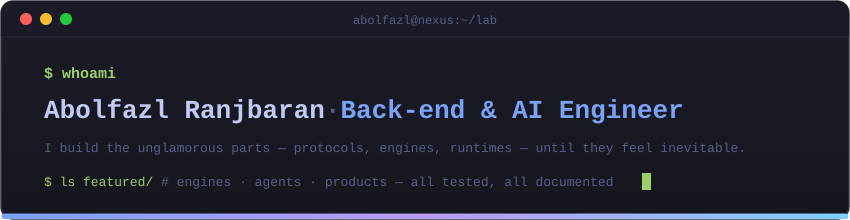

# Abolfazl Ranjbaran



[](https://github.com/Abolfazlrwm)

[](https://github.com/Abolfazlrwm)
[](https://www.linkedin.com/in/abolfazl-ranjbaran-8307b1353/)
[](https://t.me/Abolfazl_rwm)
[](mailto:abolfazlranjbaran.dev@gmail.com)

> *I like difficult problems — not because they're easy to explain, but because they're interesting to solve.*

Computer Engineering @ IUT. All open source, all engineered the same way: clear boundaries, real tests, written decisions.

---

## ⭐ Featured

| Repo | What it is |
|---|---|
| [**NexusHub**](https://github.com/Abolfazlrwm/NexusHub)   | Self-hosted AI agent platform on top of NexusAgent — tool calling, streaming, memory & RAG, **eval-first with full trace observability.** |
| [**SecureSync**](https://github.com/Abolfazlrwm/SecureSync)   | Encrypted P2P file synchronization engine — async networking, E2E encryption, Clean Architecture. **576 tests · 94% coverage · CI on 3 OSes · 27 ADRs · v1.6.** |
| [**docubot**](https://github.com/Abolfazlrwm/docubot)   | Production-grade RAG knowledge-base backend — Django 5.2 + pgvector + Celery, streaming answers with citations. **298 tests · 94.7% coverage.** |
| [**forecastforge**](https://github.com/Abolfazlrwm/forecastforge)   | Reproducible time-series forecasting — **leakage-safe walk-forward backtesting**, strict mypy, 85% coverage floor, honest benchmarks. |
| [**football-battle-arena**](https://github.com/Abolfazlrwm/football-battle-arena)   | Cinematic football website — every club is a battle team. Next.js · **[live demo](https://football-battle-arena.vercel.app).** |
| [**awesome-scripts**](https://github.com/Abolfazlrwm/awesome-scripts)   | 38 ready-to-use Telegram bots, web and desktop tools — **my most-starred work (80+ ⭐).** |

---

## ⚙️ THE LAB

### 🔐 Systems & Networking

| Project | What it is |
|---|---|
| [**SecureSync**](https://github.com/Abolfazlrwm/SecureSync) | Encrypted P2P file synchronization engine — async networking, end-to-end encryption, Clean Architecture. **576 tests · 94% coverage · CI on 3 OSes · 27 ADRs · v1.6.** |
| [**NetScope**](https://github.com/Abolfazlrwm/netscope) | Network troubleshooting that tells you whether the problem is your Wi-Fi, your ISP or the service — **with evidence, not just ping numbers.** 525 tests. |
| [**live-attack-map**](https://github.com/Abolfazlrwm/live-attack-map) | SSH honeypot that catches **real** brute-force attempts and streams them to an animated world map. **[🔴 live demo](https://live-attack-map-demo.onrender.com)** |
| [**hyperfinder**](https://github.com/Abolfazlrwm/hyperfinder) | Multi-threaded file search engine in **C++17** — built on a custom thread pool. |

### 🤖 AI & Agents

| Project | What it is |
|---|---|
| [**NexusHub**](https://github.com/Abolfazlrwm/NexusHub) | Self-hosted AI agent platform on top of NexusAgent — tool calling, streaming, memory & RAG, **eval-first with full trace observability.** |
| [**NexusAgent**](https://github.com/Abolfazlrwm/nexusagent) | Modular runtime for AI agents — agents, providers, tools, memory, and a small readable core. |
| [**docubot**](https://github.com/Abolfazlrwm/docubot) | Production-grade RAG knowledge-base backend — Django 5.2 + pgvector + Celery, streaming answers **with citations. 298 tests · 94.7% coverage.** |
| [**ForecastForge**](https://github.com/Abolfazlrwm/forecastforge) | Reproducible time-series forecasting with **leakage-safe walk-forward backtesting** — strict mypy, 85% coverage floor, ADR-driven. |
| [**Machine-Learning Lab**](https://github.com/Abolfazlrwm/Machine-Learning) | Persian **RAG assistant with hybrid retrieval** — BM25 built from scratch, fused with multilingual E5 via **RRF**, RAGAS-style evaluation on a golden set, FastAPI + Docker serving. **121 tests · 3 CI jobs · 🤗 [live demo in your browser](https://huggingface.co/spaces/Abol0pati/farsi-rag-assistant).** |

### 🚀 Products & Tools

| Project | What it is |
|---|---|
| [**awesome-scripts**](https://github.com/Abolfazlrwm/awesome-scripts) | 38 ready-to-use Telegram bots, web and desktop tools — **my most-starred work (80+ ⭐).** |
| [**FlowForge**](https://github.com/Abolfazlrwm/flowforge) | Django workflow engine — outbox, leases, fencing tokens, OpenAPI SDK, failure-injection test suite. **v1.0.0 shipped · [docs](https://abolfazlrwm.github.io/flowforge/).** |
| [**Football Battle Arena**](https://github.com/Abolfazlrwm/football-battle-arena) | Cinematic football website — every club is a battle team. Next.js · [live demo](https://football-battle-arena.vercel.app). |

---

## 🔨 HOW I BUILD

```text
01  UNDERSTAND   Start with the problem, not the framework.
02  DESIGN       Think about boundaries, trade-offs and failure modes.
03  BUILD        Make it real.
04  BREAK        Test the things that shouldn't fail.
05  DOCUMENT     If a decision matters, write down why. (30+ ADRs and counting.)
```

## ◉ CURRENTLY BUILDING

```text
◉ NexusHub   → agent evals, deployment stories, first external contributors
◉ NetScope   → from MVP to a real diagnostic platform
◉ NexusAgent → tool selection and memory
◉ apache/airflow → scheduler follow-up work from the #76629 review feedback
```

---

## 🌍 OPEN SOURCE

| Project | What I did | Status |
|---|---|---|
| [**Apache Airflow**](https://github.com/apache/airflow) | [#76629](https://github.com/apache/airflow/pull/76629) — DAG-level `on_failure_callback` never fired; the scheduler only logged `callback is empty`. Root-caused a SQLAlchemy session-recovery gap in the scheduler's callback-production path, fixed it, and added failure-mode tests that simulate the poisoned-session state **for real** (genuine `IntegrityError` flush, not mocks). Closes [#63374](https://github.com/apache/airflow/issues/63374). | ✅ CI green on sqlite · postgres · mysql — reviewed, awaiting merge |
| [**Apache Airflow**](https://github.com/apache/airflow) | [#76627](https://github.com/apache/airflow/pull/76627) — operator extra links are resolved through XCom for every task instance, even when the URL is constant, so a link that was never pushed renders empty. Added static extra links rendered straight from the operator definition (docs, dashboards, consoles) with no XCom round-trip, plus UI renderer tests. Closes [#55432](https://github.com/apache/airflow/issues/55432). | 🔎 open — mergeable, awaiting review |
| [**sqlfluff**](https://github.com/sqlfluff/sqlfluff) | [#9072](https://github.com/sqlfluff/sqlfluff/pull/9072) — `LT02` flagged `VALUES`-clause indents inside brackets (`FROM (VALUES …)`, `WITH … AS (VALUES …)`), where the brackets already provide the indentation. Fixes the false positive and adds regression tests for both bracketed forms. Closes [#9055](https://github.com/sqlfluff/sqlfluff/issues/9055). | 🔎 open — in review |

---

## 🧰 TOOLBOX

|  |  |
|---|---|
| **Languages** |      |
| **Back-end & APIs** |       |
| **AI & Data** |      |
| **Data & Messaging** |    |
| **Front-end** |     |
| **Infra & CI/CD** |     |
| **Testing & Quality** |     |

---

### 🐍 Watch me eat commits

<picture>
  <source media="(prefers-color-scheme: dark)" srcset="https://raw.githubusercontent.com/Abolfazlrwm/Abolfazlrwm/output/github-contribution-grid-snake-dark.svg" />
  <source media="(prefers-color-scheme: light)" srcset="https://raw.githubusercontent.com/Abolfazlrwm/Abolfazlrwm/output/github-contribution-grid-snake.svg" />
  
</picture>

---

## 🤝 WORK WITH ME

I take on projects where the backend actually has to work:

- **Telegram bots** — shops, subscriptions, games, moderation, AI assistants
- **Web backends & apps** — Django / Flask / Next.js
- **Systems & security tooling** — networking tools, honeypots, encrypted communication
- **AI integration** — adding ML and LLM features to existing products

**Let's build something.**

[](https://t.me/Abolfazl_rwm)
[](mailto:abolfazlranjbaran.dev@gmail.com)
