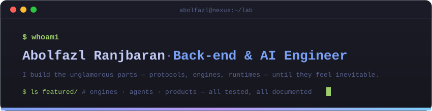

# Abolfazl Ranjbaran



[](https://github.com/Abolfazlrwm)

[](https://github.com/Abolfazlrwm)
[](https://www.linkedin.com/in/abolfazl-ranjbaran-8307b1353/)
[](https://t.me/Abolfazl_rwm)
[](mailto:abolfazlranjbaran.dev@gmail.com)

> *I like difficult problems — not because they're easy to explain, but because they're interesting to solve.*

Computer Engineering @ IUT. All open source, all engineered the same way: clear boundaries, real tests, written decisions.

**I build secure distributed systems and applied AI** — from async networking and workflow engines to from-scratch deep learning. Below: the five projects that prove it, the full lab, and an honest map of what each project does **and does not** demonstrate.

---

## ⭐ Flagships — what each one proves

| Repo | What it proves | Status |
|---|---|---|
| [**SecureSync**](https://github.com/Abolfazlrwm/SecureSync)  | Async networking, an E2E-encrypted protocol composed from audited primitives (X25519 · AES-256-GCM / ChaCha20-Poly1305 · Ed25519), delta sync, Clean Architecture — with a published threat model and a security test suite. **734 tests · 94% coverage · CI on 3 OSes · 27 ADRs.** | v1.6 shipped |
| [**flowforge**](https://github.com/Abolfazlrwm/flowforge)  | Distributed-systems semantics done properly: leases, fencing tokens, transactional outbox, at-least-once delivery — a failure model mapped to tests, not to hope. | v1.0.1 · [docs](https://abolfazlrwm.github.io/flowforge/) |
| [**nexusagent**](https://github.com/Abolfazlrwm/nexusagent)  | A zero-runtime-dependency agent runtime you can read in one sitting: bounded tool loop, async, SQLite memory, provider abstraction, contract-tested. | on [PyPI](https://pypi.org/project/nexusagent-runtime/) |
| [**docubot**](https://github.com/Abolfazlrwm/docubot)  | Backend engineering at production standard: Django 5.2 + pgvector + Celery, hybrid retrieval with RRF, idempotent async pipeline, multi-tenant scoping, JWT rotation — every security claim mapped to its tests. **330 tests · 95% coverage.** | v1.4 shipped |
| [**Machine-Learning** → `tiny-gpt-from-scratch`](https://github.com/Abolfazlrwm/Machine-Learning)  | Deep learning from scratch in raw NumPy: reverse-mode autograd + decoder-only transformer + Adam, every primitive checked against numerical gradients. Understanding, not library calls. | 32 tests · 🤗 [live demo](https://huggingface.co/spaces/Abol0pati/tiny-gpt-fa) |

---

## ⚙️ THE LAB

### 🔐 Systems & Networking

| Project | What it is |
|---|---|
| [**SecureSync**](https://github.com/Abolfazlrwm/SecureSync) | Encrypted P2P file synchronization engine — async networking, end-to-end encryption, Clean Architecture. **734 tests · 94% coverage · CI on 3 OSes · 27 ADRs · v1.6.** |
| [**NetScope**](https://github.com/Abolfazlrwm/netscope) | Network troubleshooting that tells you whether the problem is your Wi-Fi, your ISP or the service — **with evidence, not just ping numbers.** 941 tests. |
| [**live-attack-map**](https://github.com/Abolfazlrwm/live-attack-map) | SSH honeypot that catches **real** brute-force attempts and streams them to an animated world map. **[🔴 live demo](https://live-attack-map-demo.onrender.com)** |
| [**hyperfinder**](https://github.com/Abolfazlrwm/hyperfinder) | Multi-threaded file search engine in **C++17** — built on a custom thread pool. |
| [**IUT_Food**](https://github.com/Abolfazlrwm/IUT_Food) | Campus food-ordering in Qt/C++17 — wallet, coupons, live order tracking, TCP server & SQLite. |
| [**Car-Rental-System**](https://github.com/Abolfazlrwm/Car-Rental-System) | Rental management in C++17 — hand-written AVL / hash table / heap, salted SHA-256 auth. **5,416 checks (CI-run), zero dependencies · [docs & demo](https://abolfazlrwm.github.io/Car-Rental-System/).** |

> 🔒 Three more systems — **My-Git** (a version-control system from scratch in C++, content-addressable storage), **PitchVision-AI** (football video intelligence with YOLOv8 → ByteTrack) and **Vehicle** (dealership management) — are private during review. Happy to walk through them in an interview.

### 🤖 AI & Agents

| Project | What it is |
|---|---|
| [**NexusHub**](https://github.com/Abolfazlrwm/NexusHub) | Self-hosted AI agent platform on top of NexusAgent — **alpha:** runtime, gateway and per-run tracing shipped; dashboard, RAG and the eval engine are on the roadmap. |
| [**NexusAgent**](https://github.com/Abolfazlrwm/nexusagent) | Modular runtime for AI agents — agents, providers, tools, memory, and a small readable core. **On [PyPI](https://pypi.org/project/nexusagent-runtime/) — `pip install nexusagent-runtime`.** |
| [**docubot**](https://github.com/Abolfazlrwm/docubot) | Production-grade RAG knowledge-base backend — Django 5.2 + pgvector + Celery, streaming answers **with citations. 330 tests · 95% coverage.** |
| [**ForecastForge**](https://github.com/Abolfazlrwm/forecastforge) | Reproducible time-series forecasting with **leakage-safe walk-forward backtesting** — strict mypy, 85% coverage floor, ADR-driven. **Pre-alpha: serving & monitoring not implemented.** |
| [**Machine-Learning**](https://github.com/Abolfazlrwm/Machine-Learning) | **Flagship: `tiny-gpt-from-scratch`** — reverse-mode autograd + decoder-only transformer + Adam in raw NumPy, gradient-checked. **32 tests · 🤗 [live demo](https://huggingface.co/spaces/Abol0pati/tiny-gpt-fa).** Plus the **Persian RAG assistant** — BM25 from scratch fused with E5 via **RRF**, RAGAS-style golden-set eval. **183 tests · 🤗 [live demo](https://huggingface.co/spaces/Abol0pati/farsi-rag-assistant).** |
| [**sokhan**](https://github.com/Abolfazlrwm/sokhan) | Persian-first speech-to-text — voice message in, transcript & summary out. Self-hostable (FastAPI + faster-whisper + Telegram). **🤗 [live demo](https://huggingface.co/spaces/Abol0pati/sokhan-fa-demo).** |
| [**persianeval**](https://github.com/Abolfazlrwm/persianeval) | The first serious open-source benchmark for LLMs on Persian — 8 tasks, reproducible harness, weekly leaderboard. **[Leaderboard & docs](https://abolfazlrwm.github.io/persianeval/).** |

### 🚀 Products & Tools

| Project | What it is |
|---|---|
| [**awesome-scripts**](https://github.com/Abolfazlrwm/awesome-scripts) | 109 ready-to-run projects — Telegram bots, web tools & desktop utilities — **my most-starred work (81 ⭐ · [interactive gallery](https://abolfazlrwm.github.io/awesome-scripts/)).** *Community utility collection — breadth, not engineering depth.* |
| [**FlowForge**](https://github.com/Abolfazlrwm/flowforge) | Django workflow engine — outbox, leases, fencing tokens, OpenAPI SDK, failure-injection test suite. **v1.0.1 shipped · [docs](https://abolfazlrwm.github.io/flowforge/).** |
| [**stacksmith**](https://github.com/Abolfazlrwm/stacksmith) | Production deployment kit for docubot — **30 ADRs**, **29 CI workflows incl. 11 drill suites**, cosign-signed multi-arch images, disaster recovery, Terraform. **v1.2.0 stable.** |
| [**Football Battle Arena**](https://github.com/Abolfazlrwm/football-battle-arena) | Cinematic football website — every club is a battle team. Next.js · [live demo](https://football-battle-arena.vercel.app). *Frontend showcase.* |
| [**growthplanner**](https://github.com/Abolfazlrwm/growthplanner) | A calm Persian/English planner connecting big goals to daily tasks — Django + DRF + HTMX. **[live demo](https://growthplanner-kappa.vercel.app).** |
| [**nobat**](https://github.com/Abolfazlrwm/nobat) | Multi-business appointment booking — Laravel 12 + Vue 3, RTL & Jalali calendar. **[live demo](https://nobat-demo.onrender.com).** |
| [**rategate**](https://github.com/Abolfazlrwm/rategate) | Distributed rate limiting in Go — token bucket & sliding window, REST + gRPC, Prometheus & OpenTelemetry. |
| [**Security**](https://github.com/Abolfazlrwm/Security) | Nine-tool security toolkit — subdomain enum, port scan, takeover detection, JWT analyzer, CVE lookup. Zero dependencies, CI-tested. |

---

## 🧭 PORTFOLIO MAP — what each project proves and what it does not (yet)

| Project | Proves | Does NOT prove (yet) |
|---|---|---|
| [NexusHub](https://github.com/Abolfazlrwm/NexusHub) | Agent-platform architecture; gateway + tracing engineering | Dashboard, RAG, Redis queue, eval engine are **roadmap** — the platform is alpha, not a finished product |
| [forecastforge](https://github.com/Abolfazlrwm/forecastforge) | Leakage-safe backtesting discipline; strict typing | Serving, monitoring, experiment tracking — **pre-alpha** |
| [Machine-Learning](https://github.com/Abolfazlrwm/Machine-Learning) | From-scratch DL internals + a fully-evaluated applied RAG pipeline | MLOps (tracking / registry / drift monitoring) is not built yet |
| [docubot](https://github.com/Abolfazlrwm/docubot) | Production-grade backend + security claims mapped to tests | Large-scale database operations (replication / sharding) are not demonstrated |
| [stacksmith](https://github.com/Abolfazlrwm/stacksmith) | Real ops maturity: 30 ADRs, 29 CI workflows, DR drills, signed images | Kubernetes — single-VPS compose + Terraform only |
| [IUT_Food](https://github.com/Abolfazlrwm/IUT_Food) | Client-server systems engineering in C++/Qt | Course-project scale — not a distributed system |
| [awesome-scripts](https://github.com/Abolfazlrwm/awesome-scripts) | Community usefulness (81 ⭐) | Engineering depth — breadth, not depth |
| [football-battle-arena](https://github.com/Abolfazlrwm/football-battle-arena) | Clean, tested frontend delivery | Deep frontend architecture — it is a showcase |

Three projects touch RAG and two touch agents — that is specialization, not
repetition: **Machine-Learning/rag-farsi-assistant** is the research lab where
techniques are invented and evaluated; **docubot** is the product that hardens
those ideas into a multi-tenant service; **nexusagent** is the reusable runtime
(and NexusHub, its consumer, is the platform being built around it).

---

## 🎯 WHAT I HAVE NOT DEMONSTRATED (YET)

Saying it myself before an interviewer finds it:

- **Kubernetes / cloud-native at scale** — stacksmith is compose + Terraform on a single VPS; no K8s evidence yet (planned for flowforge).
- **Computer vision in public** — PitchVision-AI (YOLOv8 → ByteTrack) is private during review; no public CV project yet.
- **MLOps** — no complete experiment-tracking / model-registry / drift-monitoring pipeline shipped (forecastforge is pre-alpha).
- **Databases at scale** — pgvector, Postgres and SQLite, yes; replication, sharding and query optimization under real load, no.
- **A formal crypto audit** — SecureSync composes audited primitives and publishes a threat model ([docs/security.md](https://github.com/Abolfazlrwm/SecureSync/blob/main/docs/security.md)), but the handshake composition is custom and unaudited, and says so.

---

## 🔨 HOW I BUILD

```text
01  UNDERSTAND   Start with the problem, not the framework.
02  DESIGN       Think about boundaries, trade-offs and failure modes.
03  BUILD        Make it real.
04  BREAK        Test the things that shouldn't fail.
05  DOCUMENT     If a decision matters, write down why. (30+ ADRs and counting.)
```

## ◉ CURRENTLY BUILDING

```text
◉ NexusHub   → agent evals, deployment stories, first external contributors
◉ NetScope   → from MVP to a real diagnostic platform
◉ NexusAgent → tool selection and memory
◉ meta/astryx → InputGroup a11y fix in spec review (#11418)
◉ apache/airflow → scheduler follow-up work from the #76629 review feedback
```

---

## 🌍 OPEN SOURCE

| Project | What I did | Status |
|---|---|---|
| [**Meta Astryx**](https://github.com/meta/astryx) | [#11418](https://github.com/meta/astryx/pull/11418) — inside `InputGroup` a group `error` status never reached the fields' `aria-invalid`, so screen readers announced a rejected form as valid. Root-caused the missing status propagation, fixed it across all eleven admitted input kinds (incl. the native time picker), and resolved three rounds of the repo's review bot. Closes [#8974](https://github.com/meta/astryx/issues/8974). | 🟡 all automated gates green — awaiting engineering-owner spec decision & CLA |
| [**Apache Airflow**](https://github.com/apache/airflow) | [#76629](https://github.com/apache/airflow/pull/76629) — DAG-level `on_failure_callback` never fired; the scheduler only logged `callback is empty`. Root-caused a SQLAlchemy session-recovery gap in the scheduler's callback-production path, fixed it, and added failure-mode tests that simulate the poisoned-session state **for real** (genuine `IntegrityError` flush, not mocks). Closes [#63374](https://github.com/apache/airflow/issues/63374). | ✅ CI green on sqlite · postgres · mysql — reviewed, awaiting merge |
| [**Apache Airflow**](https://github.com/apache/airflow) | [#76627](https://github.com/apache/airflow/pull/76627) — operator extra links are resolved through XCom for every task instance, even when the URL is constant, so a link that was never pushed renders empty. Added static extra links rendered straight from the operator definition (docs, dashboards, consoles) with no XCom round-trip, plus UI renderer tests. Closes [#55432](https://github.com/apache/airflow/issues/55432). | 🔎 open — mergeable, awaiting review |
| [**sqlfluff**](https://github.com/sqlfluff/sqlfluff) | [#9072](https://github.com/sqlfluff/sqlfluff/pull/9072) — `LT02` flagged `VALUES`-clause indents inside brackets (`FROM (VALUES …)`, `WITH … AS (VALUES …)`), where the brackets already provide the indentation. Fixes the false positive and adds regression tests for both bracketed forms. Closes [#9055](https://github.com/sqlfluff/sqlfluff/issues/9055). | ⭕ closed — not merged |

---

## 🧰 TOOLBOX

|  |  |
|---|---|
| **Languages** |      |
| **Back-end & APIs** |       |
| **AI & Data** |      |
| **Data & Messaging** |    |
| **Front-end** |     |
| **Infra & CI/CD** |     |
| **Testing & Quality** |     |

---

### 🐍 Watch me eat commits

<picture>
  <source media="(prefers-color-scheme: dark)" srcset="https://raw.githubusercontent.com/Abolfazlrwm/Abolfazlrwm/output/github-contribution-grid-snake-dark.svg" />
  <source media="(prefers-color-scheme: light)" srcset="https://raw.githubusercontent.com/Abolfazlrwm/Abolfazlrwm/output/github-contribution-grid-snake.svg" />
  
</picture>

---

## 🤝 WORK WITH ME

I take on projects where the backend actually has to work:

- **Telegram bots** — shops, subscriptions, games, moderation, AI assistants
- **Web backends & apps** — Django / Flask / Next.js
- **Systems & security tooling** — networking tools, honeypots, encrypted communication
- **AI integration** — adding ML and LLM features to existing products

**Let's build something.**

[](https://t.me/Abolfazl_rwm)
[](mailto:abolfazlranjbaran.dev@gmail.com)
